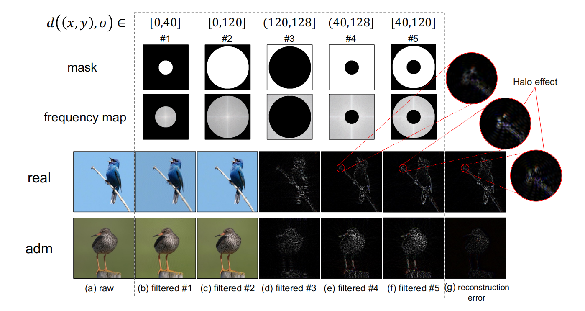
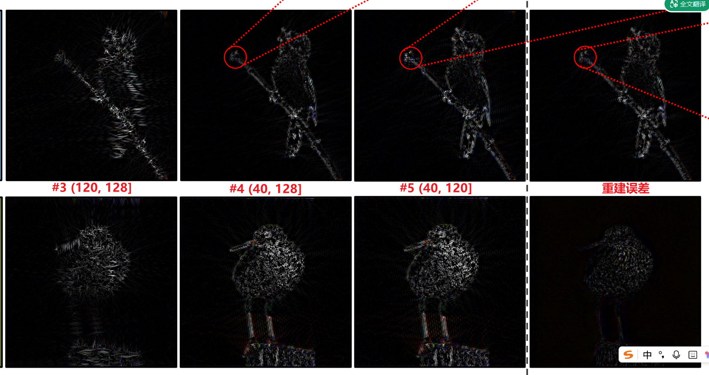
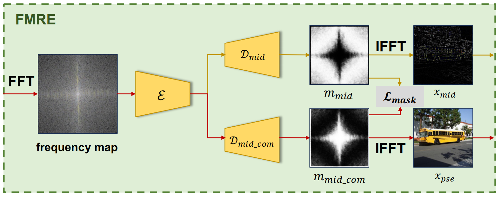
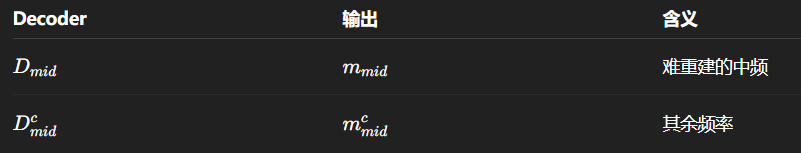
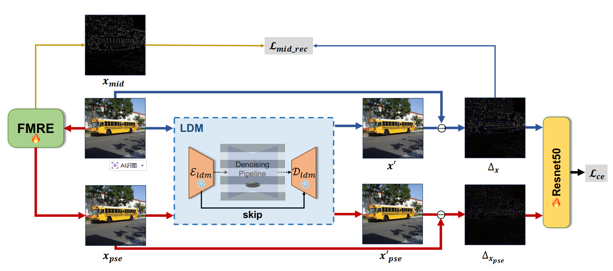

# FIRE：基于频率引导重建误差的扩散生成图像鲁棒检测

## 摘要

扩散模型的快速发展显著提升了高质量图像的生成能力，但也使得生成图像与真实图像的区分难度日益增加，并引发了人们对潜在滥用的担忧。本文观察到，**扩散模型难以准确重建真实图像中的中频信息**，这表明该局限性可作为检测扩散模型生成图像的线索。基于此，我们提出了一种名为频率引导重建误差（FIRE）的新方法。据我们所知，FIRE 是首个研究频率分解对重建误差影响的方法。FIRE 评估了频率分解前后重建误差的变化，为识别扩散模型生成的图像提供了一种稳健的方法。大量实验表明，FIRE 能够有效地推广到未见过的扩散模型，并且对各种扰动保持鲁棒性。


扩散模型生成的图像受二次去噪重建的影响较小

作者认为扩散过程中的重建误差表示的是扩散模型难以准确重建的图像部分，具体来说，生成图像经过扩散过程之后，更接近模型的潜在空间，因此重建时受影响较小，重建误差低。真实图像含有扩散模型难以完美捕捉的信息，导致重建误差较高。

作者经过频率分析进一步指出，这种难以重建的信息主要集中在中频区域，而非单纯的高频（现有工作观察到高频主导）

现有的重建误差方法的主要问题：

1. 直接将完整的重建误差图输入后端分类器，其中不仅包含有用的难以重建信号，还混杂了内容偏差和扩散过程引入的噪声，这降低了特征的区分度。
2. 泛化能力差
3. 缺乏对难以重建信息的细化：虽然已知误差主要出现在高频，但现有方法未针对性地分离出最关键的频率带（尤其是中频），导致检测鲁棒性不足。


## 实验基于一个假设：重建误差主要集中在中频区域，这个假设怎么得来的？

需要理解这张图：



作者对图像做了FFT+低频居中，所以中心区域是低频（颜色、亮度、物体大轮廓），而越往外频率越高（边缘、纹理、噪声），可以这样理解：

```
中心圆 --》 低频
中间环 --》 中频
外圈 --》 高频
```

adm这一行是生成的图像

b-f都是在频域里只保留某一圈频率，再IFFT回到空间域，论文中写的是d((x, y), o) ∈ [a, b] 的频率保留，其余清零。

放大：



filtered #1只保留非常低频，看起来很模糊，只有颜色和大形状但没有纹理和边缘

filtered #3 (120, 128] 高频，纯边缘、纹理

filtered #4 (40, 128] 中高频 有轮廓、纹理、结构和少量颜色（光晕Halo）

filtered #5  (40, 120] 中频 

核心观察：**真实图像的**重建误差长得非常像filtered #5（中频），尤其是有明显的光晕（红圈处），也就是说重建误差约等于中频信息，也就是说**真实图像的中频信息，扩散模型很难重建**。而生成图像本身就是扩散模型生成的，其中频本来就不真实，所以重建误差很小。

因此FIRE得到一个核心假设：**重建误差主要集中在中频区域**


## 本文贡献

FIRE由频率掩膜细化模块（FMRE）和后端分类器组成，FMRE细化扩散模型难以重建的中频区域，并滤除这些频率分量；后端分类器随后评估分离中频分量前后重建误差的变化，并以此作为分类线索

值得注意的是，为了更好地使频率引导与其对重建结果的后续影响相匹配，我们创新性地将重建流程集成到检测框架中，仅使用潜在扩散模型的自编码器（by using only the autoencoder (AE) of a latent DM (LDM)），从而绕过了复杂的去噪过程。这种端到端的学习方法使变形模型更好地与检测任务相匹配

## 实验

FIRE核心思想：真实图像中存在 diffusion 模型最难重建的中频信息，而生成图像在这些中频上是先天缺失的； 对比**去掉中频前后**的重建误差变化，就能区分真图和假图。

**为什么“重建误差”能区分真假图像？**——这是来自 DIRE / AEROBLADE 论文中，Diffusion模型生成图像本来就在模型的流形（mainfold）上，再重建一次变化很小，而真实图像不完全服从diffusion学到的分布，重建会丢失信息，产生较大的误差。但传统方法如DIRE，直接把整张重建误差图丢给分类器，重建误差里混着噪声等，导致模型泛化能力差。本文观察到：diffusion重建不好的是中频。所以FIRE的策略是：不要只看重建误差大不大，而是看去掉中频之后，重建误差变化了多少。

### FIRE完整工作流程

#### 1、原图 --》重建误差

对输入图像x
$$
x' = \text{AE}(x), \quad \Delta x = |x - x'|
$$
AE表示重建一次，这里只用 Stable Diffusion 的 AE，不走完整 denoising

#### 2、FFT--》频率分解

$$
F(x) = \text{FFT}(x)
$$

得到频谱（低频在中心）

#### 3、FMRE：找最难重建的中频区域

学一个mask m_mid，专门定位与△x（重建误差）最对齐的频率区域
$$
x_{mid} = \text{IFFT}(F(x) \odot m_{mid})
$$

#### 4、构造“伪生成图像”

把中频信息去掉：
$$
x_{pse} = \text{IFFT}(F(x) \odot (1 - m_{mid}))
$$

#### 5、再算一次重建误差

$$
\Delta x_{pse} = |x'_{pse} - x_{pse}|
$$

对伪生成图像进行一次重建，然后算重建误差

#### 6、把两张误差图拼起来，分类

$$
[\Delta x, \Delta x_{pse}] \xrightarrow{\text{Classifier}} \text{Real / Fake}
$$


### 预定义频率掩码

FFT后，低频被shift到中心，中心点是o=(128, 128)，中频掩码的数学定义：
$$
M_{mid}(u,v) = \begin{cases} 
1, & \text{if } d((u,v),o) \in [40,120] \\
0, & \text{otherwise}
\end{cases}
$$
d((u,v),o)是频域点到中心的欧氏距离，[40, 120]是作者人为规定的中频环

对应的补集掩码：
$$
M_{mid}^c = 1 - M_{mid}
$$
即中频以外的低频+高频


### FMRE

FMRE 是一个在频域中，自动学习 diffusion 最难重建的中频区域的掩码生成模块。FMRE是一个**共享编码器 + 双解码器**的结构。

figure2只是说明最难进行重建的部分大概在中频，具体的定位必须学



Encoder：4个卷积层，kernel= 3×3，stride = 2，padding = 1，作用是提取哪些频率区域经常和重建误差一起出现

Decoder：



掩码约束：通过loss强制
$$
m_{mid} + m_{mid}^c \approx 1
$$
IFFT回到空间域：

​	中频成分：
$$
x_{mid} = \text{IFFT}(F(x) \odot m_{mid})
$$
​	伪生成图像：
$$
x_{pse} = \text{IFFT}(F(x) \odot m_{mid}^c)
$$

### FMRE的损失函数

1、频率先验约束 L_mask
$$
\mathcal{L}_{mask} = \|m_{mid} - M_{mid}\|_2^2 + \|m_{mid}^c - M_{mid}^c\|_2^2 + \|1 - m_{mid} - m_{mid}^c\|_2^2
$$
作用是不让模型跑出中频，不让mask坍缩，保持互补性

2、重建误差对齐约束（L_mid_rec）
$$
\mathcal{L}_{mid\_rec} = \|x_{mid} - \Delta x\|_2^2
$$
FMRE 学到的中频，在空间域上，要和重建误差长得像

3、分类任务反向约束L_ce
$$
\mathcal{L}_{ce} = -[(y \log(y') + (1 - y) \log(1 - y'))],
$$
总体损失函数，将三者相加：
$$
\mathcal{L} = \lambda_0 \mathcal{L}_{mid\_rec} + \lambda_1 \mathcal{L}_{mask} + \lambda_2 \mathcal{L}_{ce},
$$
λ0和λ1都是1/5，λ2是3/5

### LDM是什么

Latent Diffusion Model，潜空间扩散模型，不在像素空间做扩散，而是在低维潜空间中做扩散，Stable Diffusion就是LDM

传统的扩散模型DDPM直接在像素空间扩散，图像尺寸大，计算量大，LDM先把图像先压缩到一个信息密集的潜空间，再在潜空间里扩散。

```
图像 x
  ↓ Encoder（VAE）
潜变量 z
  ↓ Diffusion（U-Net）
z'
  ↓ Decoder（VAE）
图像 x'

```

在FIRE中LDM的作用是计算重建误差：
$$
R(x) = D_{ldm}(E_{ldm}(x))
$$
在 FIRE 中，LDM 并不用于图像生成，而是作为一个固定的重建模块，仅使用其编码器和解码器来计算重建误差。由于 LDM 在重建真实图像的中频纹理方面存在系统性偏差，该重建误差被用作区分真实图像与扩散生成图像的重要判别线索。

### FIRE整体框架



FMRE从x的频谱中学掩码，输出中频掩码和补集掩码，生成中频图像（上路）和伪图像（下路）

中间是LDM重建模块，图中显示编码器冻结，解码器冻结，Denoising pipeline不使用，这里只是vae，不做Diffusion反向去噪

顶部黄色路线：
$$
\mathcal{L}_{mid\_rec} = \|x_{mid} - \Delta x\|_2^2
$$
中频对齐损失，FMRE输出的中频图要在空间结构上尽量接近LDM的重建误差，即FMRE不是随便找中频，而是强制去找真正导致LDM重建失败的频率成分

Resnet：双误差图送入分类器，分类loss：
$$
\mathcal{L}_{ce} = -[(y \log(y') + (1 - y) \log(1 - y'))],
$$


