## 复习Mamba

### SSM

mamba的前身是SSM（状态空间模型）。首先定义如下变量：

X_t是t时刻的输入（连续数据），H_t是t时刻的潜在状态，Y_t是t时刻的输出。定义如下公式：

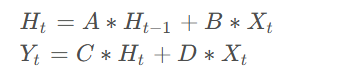

其中ABCD是四个矩阵，可学习参数，表示对应的矩阵操作。

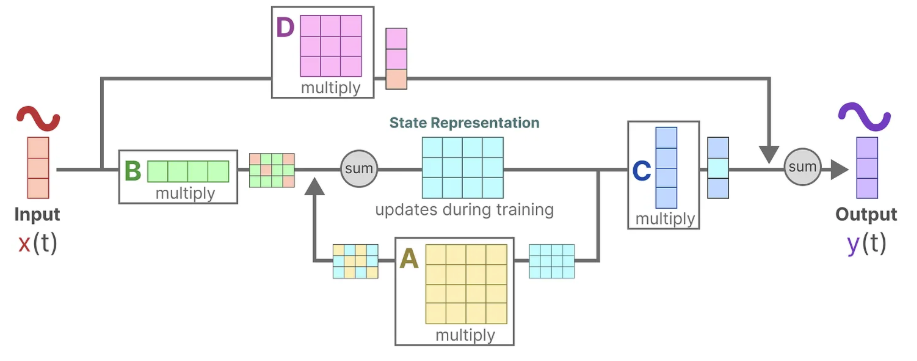

D矩阵类似于跳跃连接，如果没有D矩阵的话，SSM表示为

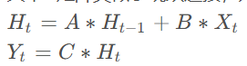

### S4：Structured State Space for Sequences

序列的结构化状态空间，相比于SSM多了两个S，分别是Structured（结构化） 和Sequences（序列）

在之前的SSM公式中，我们知道输入X(t)和输出Y(t)是与时间相关的连续性数据，而一般视觉的下游任务设计的文本数据，像素数据，都是离散的。所以现在怎么将离散数据变为连续性数据是主要问题。

采用**零阶保持技术**：每次收到离散信号时，都会保留其值一段时间，直到收到新的离散信号。其中“保持一段时间”称为步长△，其是可学习的参数

SSM中加入零阶保持技术的处理过程是：

1. 对离散输入x进行零阶保持（步长△），得到连续输入X‘
2. 对连续输入X'进行连续SSM公式得到Y'
3. 对连续输出Y'按照步长△采样，得到离散输出y

或者：

1. 对连续SSM公式中的A和B矩阵按照步长△采样，得到离散的A拔B拔
2. 将A拔B拔作为SSM公式中新的A,B，即可得到离散型SSM
3. 对离散输入x进行离散SSM，得到离散输入

离散SSM公式：

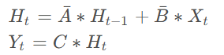

接下来考虑S4训练和测试的情况：

假设以y2为例：

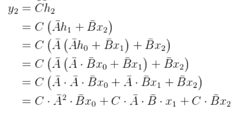

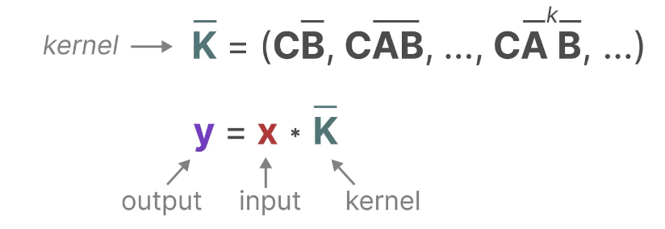

这样就写成了卷积的形式，也就是说S4可以并行训练了。推理方面还是采用RNN的方式，因为如果按照卷积形式来推理，速度还是比较慢的。

最后就是”基于HiPPO处理长序列“的新思想，主要作用在了A 矩阵的初始化上，这样初始化能方便A矩阵更好的学习。具体内容可以参考分析：https://blog.csdn.net/v_JULY_v/article/details/134923301

S4算法：

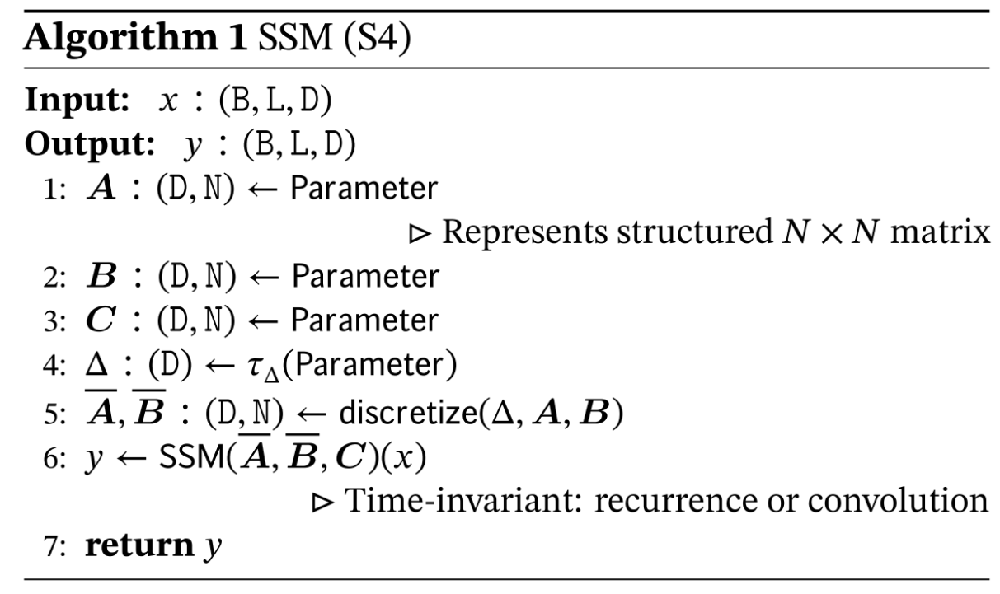

B是批次大小，L是序列长度，D是特征维度，N是状态维度

**步骤1：**A是SSM的核心参数，形状为(D, N)，虽然A的实际数学表示是NxN，但在这里被参数化为(D, N)，表示每个输入特征 d（从 1 到 D）有一个独立的向量 A_d ∈ ℝ^N。回忆：

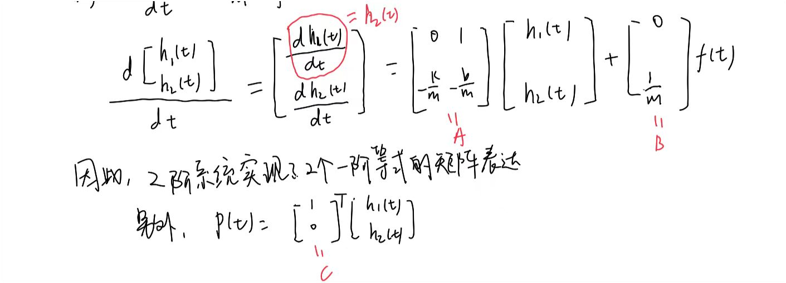

A的初始化通常从模型参数中随机初始化或使用特定方法（如 HiPPO-LegS），以确保稳定性（例如 A 的实部为负，确保系统收敛）。在连续 SSM 中，A 控制状态 h 的动态演化，类似于衰减或振荡。

**步骤2**：B是从输入到状态的投影参数，它将输入 x_t ∈ ℝ^D 映射到状态空间 ℝ^N。在 SSM 方程中，B 出现在状态更新：h'(t) = A h(t) + B x(t)。B 决定了输入如何影响状态的演化。通常随机初始化，或与 A 一起优化。

**步骤3**：C是从状态到输出的投影参数。它将状态 h_t ∈ ℝ^N 映射回输出 y_t ∈ ℝ^D。在 SSM 中，y(t) = C h(t)，C 负责从内部状态提取有用的输出。随机初始化

**步骤4**：△形状为(D)，表示每个特征的离散化步长。它是从一个参数（可能是向量）通过函数` τ_Δ` 变换得到的。 `τ_Δ` 通常是一个非线性激活函数，如 `softplus (τ_Δ(p) = log(1 + exp(p)))`，确保 Δ > 0。

在连续到离散的转换中，Δ 控制采样间隔，类似于时间分辨率。不同的特征可能需要不同的尺度，以捕捉不同频率的信号（例如，低频 vs 高频）。Δ 用于后续的离散化步骤，使模型适应变长序列或多尺度动态。

**步骤5**：这一步将连续SSM参数A和B离散化，得到离散版本A拔和B拔
$$
\bar{A} = exp(Δ A)
\\
\bar{B} = (Δ A)^{-1} (exp(Δ A) - I) B
$$
之前推导过：

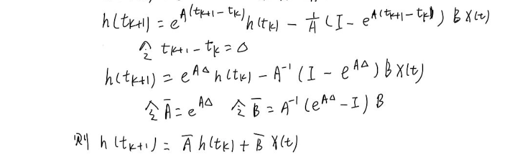

但在S4中由于A是结构化的（例如对角），计算可以简化为（如果A是对角）：
$$
\bar{A} = diag(exp(Δ A))，
\\
\bar{B} = Δ B ⊙ (exp(Δ A) - 1) / (Δ A)
$$
输出仍是 (D, N) 形状，但现在A拔和B拔适合离散序列。C 不需要离散化，因为它是输出投影。

**步骤6**：

对于每个时间步t：
$$
h_t = \bar{A} h_{t-1} + \bar{B} x_t
\\
y_t = C h_t
\\
通常初始h_0=0
$$
由于参数A拔、B拔、C不随t变化，这允许循环和卷积：

循环：逐步计算 h_t（如 RNN），适合训练（反向传播）

卷积：预计算内核
$$
K = (C \bar{B}, C \bar{A} \bar{B}, C \bar{A}^2 \bar{B}, ..., C \bar{A}^{L-1} \bar{B})
\\
y = x * K (卷积)
$$
适合推理，尤其长序列

S4 在训练时用循环，推理时用卷积切换。

#### 如何理解S4没有选择性？

“时不变”是指参数不随时间改变，矩阵ABC都和t无关，所以系统对输入的响应只取决于**输入的形状**，而不取决于**输入出现的时间**

没有选择性是指模型对所有位置使用相同的规则或者权重来聚合历史信息，不管当前输入是什么，而有选择性是指对不同的token，模型可以聚焦不同的上下文

训练完之后，A拔、B拔、C就固定了。那什么操作有选择性？——Attention有
$$
Y = \text{Softmax}(Q * K^T) * V / \sqrt{d_k};
\\
Q = W^Q * X, \quad K = W^K * X, \quad V = W^V * X
$$
即使训练完之后W_Q, W_k, W_v的参数固定了，Attention通过Q和K的内积衡量当前输入与其他位置的相关性，softmax将这些相关性转化为依赖于输入x的权重，权重是输入相关的，模型可以根据输入选择关注哪些内容

但对于S4来说，ABC矩阵在训练完之后不再改变，所以无论输入是什么，都使用同样一套规则去处理，S4像是固定的滤波器一样。

## S4 --> Mamba即S6：S4+Selective Scan algorithm

选择性扫描算法意在让Mamba像Attention那样能关注输入数据

如何让S6有选择性呢

作者的想法是增加B, C和△的维度：

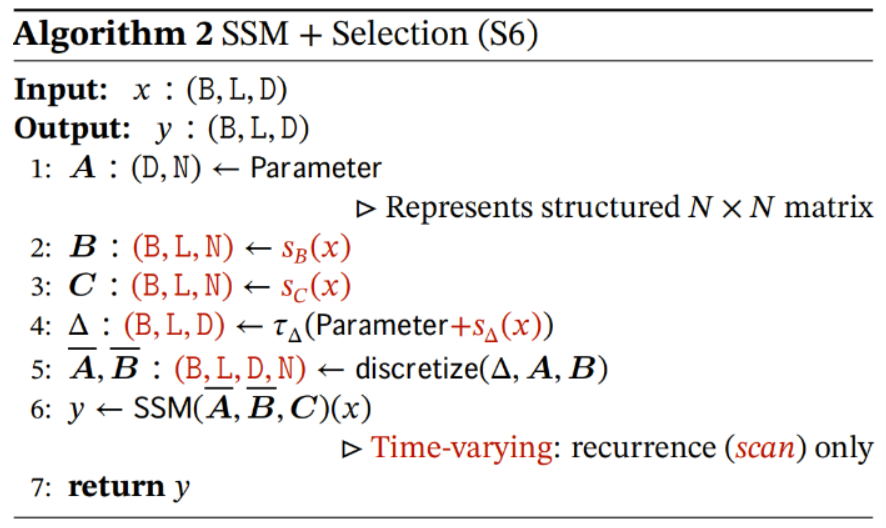

B是批次大小，L是序列长度，D是特征维度，N是状态维度

**步骤1**：与S4相同，A 是全局参数，不依赖输入 x，通过学习或 HiPPO 初始化设置。在连续 SSM 中，A 控制状态 h 的演化：`h'(t) = A h(t) + B x(t)`。在 S6 中，A 保持固定，但通过后续离散化与时间变化的 Δ 结合，实现自适应动态。

**步骤2**：S_B是一个线性投影，将x的每个时间步(B, L, D) 投影到 (B, L, N)，这体现选择机制，B依赖于当前输入，允许模型选择性地定输入 x_t 如何注入状态 h_t。类似于 RNN 的输入门，B_t 控制“注入多少”信息。

**步骤4**：`S_△(x)= Broadcast_D(Linear_1(x))` 生成，其中 Linear_1 将 x 投影到 1D 值，然后广播到 D 维度。Parameter 是一个可学习偏置 (D)，然后应用 τ_Δ，通常是 `softplus：τ_Δ(z) = log(1 + exp(z))`

`s_Δ(x)` 使 Δ 依赖输入，控制离散化步长。较大的 `Δ_t` 强调当前输入（快速更新），较小的 `Δ_t` 保留过去状态（慢衰减），实现类似遗忘门的机制。

Δ 调节连续到离散的转换，允许多尺度选择，捕捉不同频率的依赖。

**步骤5**：这一步将连续参数离散化，形状拓展到（B, L, D, N），discretize 函数：
$$
\bar{A}_t = exp(Δ_t A)
\\
\bar{B}_t = (Δ_t A)^{-1} (exp(Δ_t A) - I) B_t
$$

___

## Vision Mamba

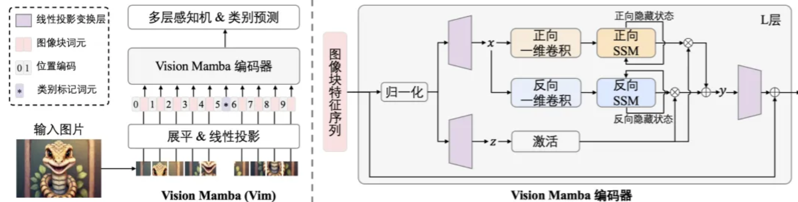

vim block process

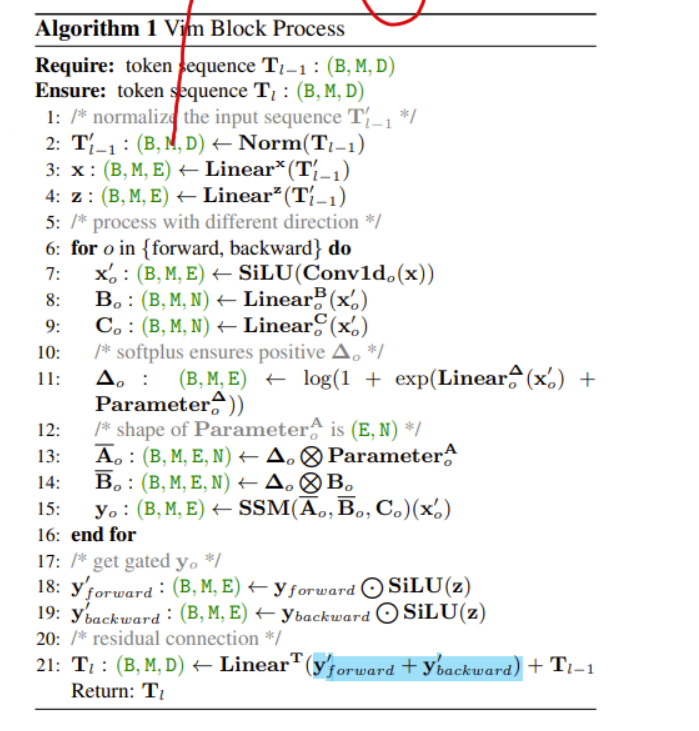