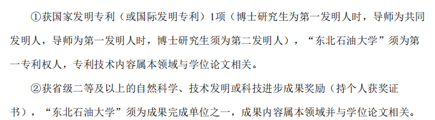

## 满足以下两个条件之一：

### 条件一：

4篇论文，其中 至少1篇论文被SCI收录 **或** 2篇论文被EI收录、至少1篇论文发表在本领域入选卓越科技期刊或中国科学引文数据库（CSCD）来源期刊（核心库）或《东北石油大学学报》或《Journal of GeoEnergy》上。

符合下列条件之一的可以减免1篇论文，但每项只限折算1篇：

**另外需要满足：**博士研究生（直博）至少在本领域国内、国际性学术会议上做会议报告（有会议官方证明）、或在本领域国内、国际性学术会议上宣读（张贴）并公开发表会议论文1篇（次），提交参会全套资料。

### 条件二：

在SPE Journal或同类高质量期刊上发表学术论文1篇，**并在 **本领域入选卓越科技期刊或中国科学引文数据库（CSCD）来源期刊（核心库）或《东北石油大学学报》或《Journal of GeoEnergy》上发表学术论文1篇。

**另外需要满足：**至少在本领域国内、国际性学术会议上做会议报告（有会议官方证明）、或在本领域国内、国际性学术会议上宣读（张贴）并公开发表会议论文1篇（次），提交参会全套资料。

___

SCI收录论文以投稿年度期刊所位列中国科学院文献情报中心《JCR期刊影响因子及分区情况》为认定依据；发表在3区以下（不含3区）开放获取（Open Access）期刊的学术论文不作为申请博士学位的学术成果；发表在中国科学院文献情报中心所发布最新《国际期刊预警名单》中（以投稿时间为准）期刊的学术论文不作为申请博士学位的学术成果；