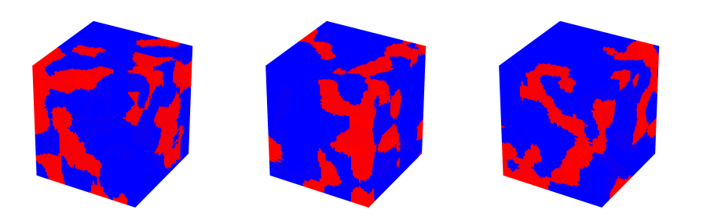
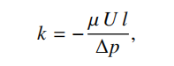
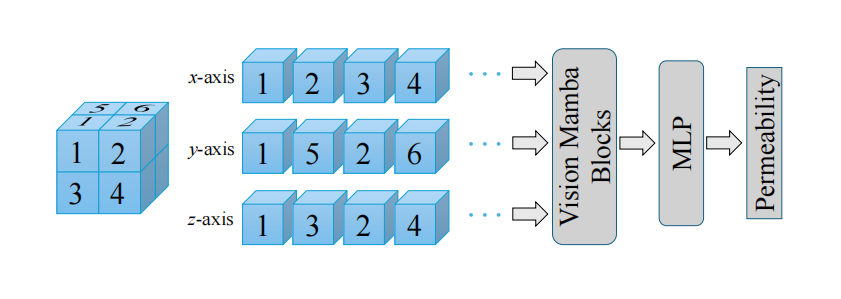
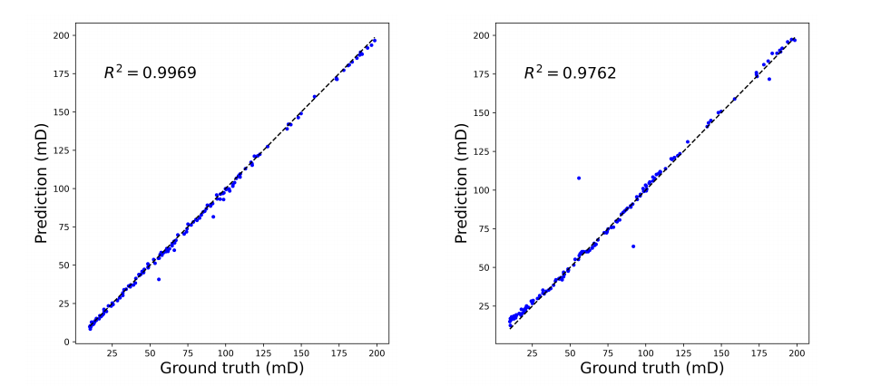
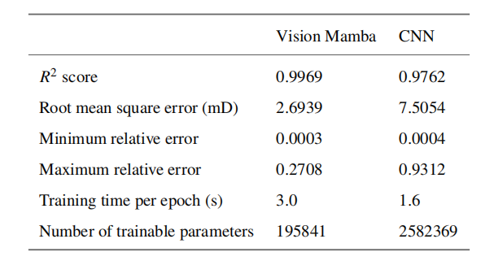
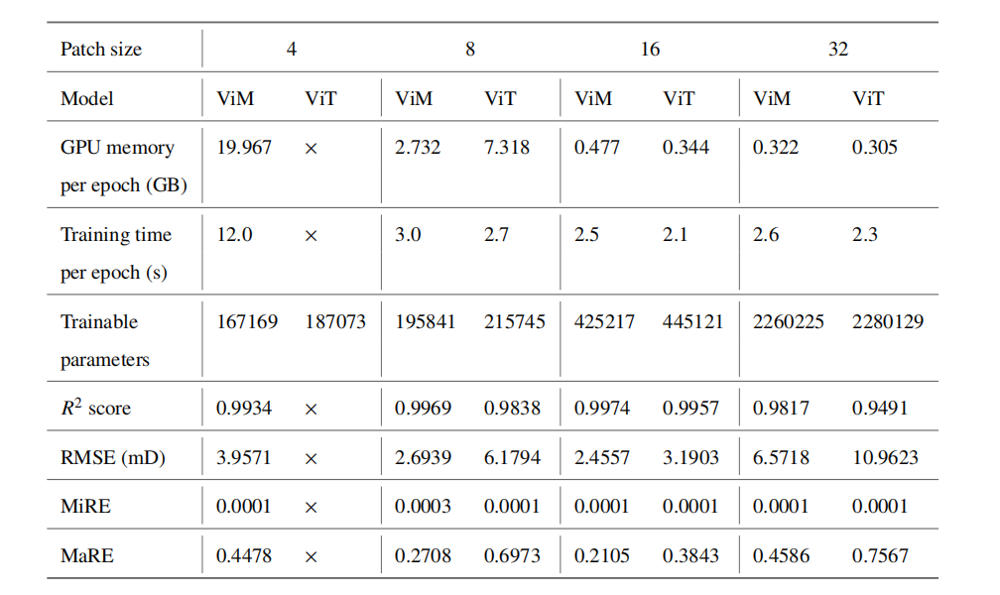
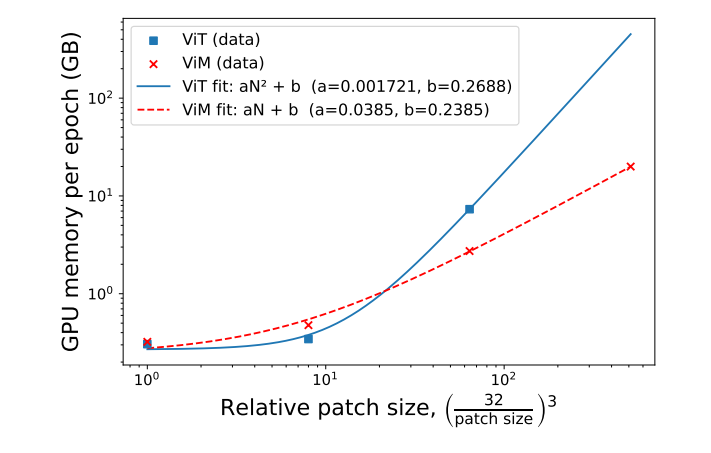

## Vision Mamba 用于多孔介质渗透率预测

Vision Mamba for Permeability Prediction of Porous Media

### Conclusion

本文提出了一种基于 Vision Mamba 的神经网络，用于预测三维多孔介质的渗透率。我们使用决定系数、均方误差以及最大和最小相对误差等评估指标验证了所提出模型的有效性。我们讨论了 Vision Mamba 相较于卷积神经网络 (CNN) 和 ViTs 在渗透率预测方面的优势。特别地，我们证明了与 CNN 相比，Vision Mamba 所需的训练参数更少，却能达到更优异的性能。此外，我们还证明 Vision Mamba 的 GPU 内存使用量与图像块大小呈线性关系，而 ViTs 的 GPU 内存使用量则呈二次方关系。因此，在 GPU 资源有限的情况下，Vision Mamba 能够更好地利用 GPU 内存。在内存方面，Vision Mamba 能够成功地使用较小的图像块大小执行机器学习实验，而 ViTs 在使用相同的较小批次大小时由于内存不足而无法进行训练。最后，我们探讨了关键超参数的影响，包括 Vision Mamba 的块数、每个块内的图像块大小以及批次大小，以突出它们对模型性能的影响。

在本文中，我们使用了 Vision Mamba 的分类分支，其中神经网络的输入代表多孔介质的几何形状，输出是渗透率的标量值。作为未来项目的思路之一，可以使用 Vision Mamba 的分割分支，这样，尽管输入仍然是描述多孔介质几何形状的三维立方体，但输出是孔隙空间内的预测速度场。当然，获得速度场后，也可以计算渗透率。然而，获取完整的速度场可以提供更多信息。这可以通过完全监督的深度学习或弱监督的深度学习来实现，如果只有速度场的稀疏观测值可用，则可以通过强制执行控制方程（例如，方程 1、2） 作为 Vision Mamba 网络的损失函数来实现。

另一个有前景的研究方向是基于 Vision Mamba 而非 Transformer 架构，开发用于多孔介质的大型语言和视觉模型。此类基础模型能够处理可变尺寸和多矿物多孔介质，从而预测其物理和几何特征，并提供交互式环境，以便在一个统一的框架内集成图像、代码、文本和数学公式。

### 数据生成

#### 生成多孔介质的3D图像

用“截断高斯方法”的数学技巧来合成这些3D图像，64x64x64。每个立方体有孔隙率（大概在12.5%~20%之间）和空间相关长度（孔洞分布的连贯性，这里设为17个网格单位）

1. 在整个64x64x64网格上随机生成数字（从“标准正态分布”抽样）
2. 用一个3D高斯滤波器“平滑”这些随机数，让它们有空间关联。滤波器的标准差是5，相关长度是17网格。
3. 把这些数字缩放到0到1之间，然后设一个阈值0.45：小于或等于0.45的点标为“孔洞”，大于0.45的标为“固体颗粒”。这样就得到一个黑白分明的3D二进制图像

每个小网格（voxel）边长0.003米，所以整个立方体边长是64*0.003=0.192米。

一共生成了1692个这样的立方体样本，然后随机分成三组：1353个用于训练AI，169个用于验证，170个用于测试



红色代表孔洞

#### 通过模拟算出每个样本的渗透率

模拟设置：在x方向施加一个均匀的压力梯度（Δp/l，像从一边推水过去）。y-z面的边界设为“无滑移”（no-slip，流体贴着墙不动）。

用一种叫“格子玻尔兹曼求解器”（lattice Boltzmann solver）的软件来计算流体运动。这解决的是“斯托克斯方程”（Stokes equations），简单说就是描述慢速、不压缩流体的数学公式：


μ是流体粘度，u和p分别表示速度场和压力场。方程(1)表示流体体积守恒（进出的量相等）。方程(2)表示压力和粘度（μ，流体黏稠度）平衡的方程。从收敛解中，利用达西定律可得到 x 方向的固有渗透率 𝑘



U表示整个样本的平均流速（固体部分速度为0），l是立方体边长。所有样本的渗透率在20 mD到200 mD之间（mD是毫达西，渗透率的单位）

### Vision Mamba

#### 输入

$$
X \in \mathbb{R}^{B \times 1 \times D \times H \times W}
$$

B是batch size，1是通道（孔/岩），DHW=64

#### Patchification

用一个3D卷积做patch embedding

kernel size = stride = patch size，例如patch size = 8,

```
64 × 64 × 64
→ 8 × 8 × 8 = 512 个 patch
```

每个patch --> 1个token（64维），得到：
$$
z_{\text{tok}} \in \mathbb{R}^{B \times C \times D' \times H' \times W'}
$$
C是embedding维度=64，D'=H'=W'=8

#### Vision Mamba Block

**1、给每一个token生成一套控制参数**

对z_tok做一个1x1x1卷积，生成5个张量：

| 名称  | 作用      | 类比             |
| ----- | --------- | ---------------- |
| g_in  | 输入门    | LSTM input gate  |
| g_out | 输出门    | LSTM output gate |
| B     | 输入权重  | 状态更新强度     |
| C     | 输出权重  | 状态读出         |
| Δ     | step size | 时间步长         |

在Vision Mamba里，输入是：
$$
z_{\text{tok}} \in \mathbb{R}^{B \times C \times D' \times H' \times W'}
$$
输出：5个张量，每个形状都一样

1x1x1卷积是对每个patch token独立处理，对某一个固定空间位置(d, h, w)，输入是：
$$
z_{\text{tok}}[:, :, d, h, w] \in \mathbb{R}^{B \times C}
$$
1x1x1卷积在这里等价于：
$$
\text{Linear}(C \to 5C)
$$
也就是：
$$
[g_{\text{in}}, g_{\text{out}}, B, C, \Delta] = W \cdot z_{\text{tok}} + b
\\
W \in \mathbb{R}^{5C \times C}
$$
关键是所有patch共享同一套W

输入：

```
输入：
z_tok: [B, 64, 8, 8, 8]

↓

1x1x1 卷积：
conv = nn.Conv3d(
    in_channels=64,
    out_channels=64*5,
    kernel_size=1,
    stride=1
)

↓

卷积输出：
out: [B, 320, 8, 8, 8]

↓

在channel维度切分：
g_in, g_out, B_t, C_t, Delta = torch.chunk(out, 5, dim=1)
每一个都是：
[B, 64, 8, 8, 8]

```

计算：

输入门g_in：
$$
u = g_{\text{in}} \odot z_{\text{tok}}
$$
类比LSTM中的input gate，当前token的信息有多少可以写进状态记忆

Δ（时间尺度）：
$$
\alpha = \exp(-A^+ \odot \Delta)
$$
控制当前patch对应的“记忆衰减速度”，△大则衰减快则更偏局部，这是vision mamba能选择性记忆的关键

**2、逐轴选择性扫描**：



把token网格看成序列，沿着每个空间轴（D'、H'、W'）扫描。每个轴的序列长度是 L_η （这里=8）,对于轴 η（比如D'），把网格扁平化成 N_seq 个序列（ N_seq=B×H′×W′=B×8×8），每个序列长8。

前向扫描（从0到L_η -1）：

隐藏状态
$$
s_t = \alpha_t \odot s_{t-1} + B_t \odot u_t
$$
输出y_fwd
$$
y_t = C_t \odot s_t + D_{\text{skip}} \odot u_t
$$
后向扫描，从末尾到开头，得到y_bwd

**3、轴融合与残差**
$$
\hat{y} = \frac{1}{2}(y^{fwd} + y^{bwd}) \quad \text{(平均)}
\\
y_\eta = g_{\text{out}} \odot \hat{y} \quad \text{(输出门过滤)}
\\
\text{三个轴平均：} \quad y = \frac{y_p + y_n + y_w'}{3}
$$
残差和MLP：
$$
z_+ = z_{\text{tok}} + y
\\
z_{\text{out}} = z_+ + M(z_+)
$$
其中M是点wise MLP（用1x1x1卷积 + GELU激活，像简单非线性变换混通道）

#### 全局池化和头部

处理完所有块后，全局平均池化，得到向量h。然后线性投影：
$$
\hat{k} = w^\top h + b
$$

### 参数和训练



左边是vision mamba，右边是CNN

### 结果与讨论

二者在测试集170个样本上对比



本文所使用的CNN：Point-cloud deep learning of porous media for permeability prediction 也是作者写的论文

本文的重点并非仅仅在于证明 Vision Mamba 在多孔介质渗透率预测精度方面始终优于 CNN，我们比较关注训练时间和可训练参数的数量

#### Vision Mamba 和 ViT比较：

batch size固定为128，减小patch size大小都会减少可训练参数的数量，但会增加 GPU 内存需求



展示了每个训练周期 GPU 内存使用量随图像块大小的变化：



patch size越小，GPU内存需求越大，且vit增长趋势显著。Vision Mamba 模型每个训练周期所需的 GPU 内存量随图像块大小的减小呈线性增长，而 ViT 模型则呈二次方增长。我们应用最小二乘法拟合，推导出描述实验中 GPU 内存需求的线性方程和二次方程。基于这些方程，我们预测当图像块大小为 4 时，ViT 每个训练周期所需的 GPU 内存约为 451 GB，这解释了为什么我们的 80 GB GPU 无法执行此机器学习实验。


## 复现

vision mamba：

```
Epoch 095/100  Train MSE: 0.000352  Val MSE: 0.001386
Epoch 096/100  Train MSE: 0.000337  Val MSE: 0.001372
Epoch 097/100  Train MSE: 0.000259  Val MSE: 0.001475
Epoch 098/100  Train MSE: 0.001314  Val MSE: 0.002870
Epoch 099/100  Train MSE: 0.001155  Val MSE: 0.001884
Epoch 100/100  Train MSE: 0.001216  Val MSE: 0.002008

Test R2: 0.9353
Relative error min: 0.0003, max: 3.6927
```

