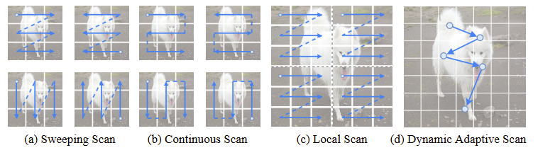
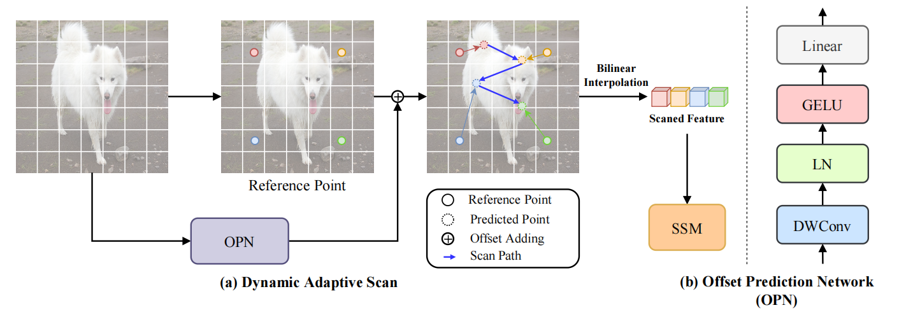
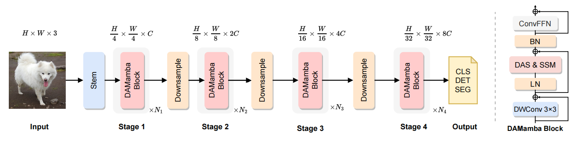
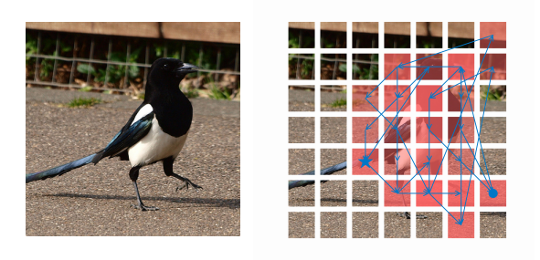

## DAMamba: Vision State Space Model with Dynamic Adaptive Scan

DAMamba：带动态自适应扫描的视觉状态空间模型

### 摘要

状态空间模型（SSM）近年来在计算机视觉领域备受关注。然而，由于图像数据的独特特性，将自然语言处理领域的 SSM 应用于计算机视觉并未超越目前最先进的卷积神经网络（CNN）和视觉变换器（ViT）。现有的视觉 SSM 主要利用手动设计的扫描将图像块局部或全局地展平为序列。这种方法破坏了图像原有的语义空间邻接关系，且缺乏灵活性，难以捕捉复杂的图像结构。为了克服这一局限性，我们提出了动态自适应扫描（DAS），一种数据驱动的方法，能够自适应地分配扫描顺序和区域。这使得模型在保持线性计算复杂度和全局建模能力的同时，拥有更灵活的建模能力。基于 DAS，我们进一步提出了视觉骨干网络 DAMamba，其在图像分类、目标检测、实例分割和语义分割等视觉任务中显著优于目前最先进的 Mamba 视觉模型。值得注意的是，它超越了一些最新的最先进的 CNN 和 ViT。

SSM的核心模块S6能根据序列中每个元素的相关性选择性地保留或丢弃信息，Mamba的S6模块通过引入一种选择性并行计算机制和硬件感知优化，不仅提供了全面的全局感受野，而且其计算复杂度与序列长度呈线性关系。这一特性使得 Mamba 在自然语言处理任务中超越了流行的 Transformer 模型。

Vim将图像分割成多个图像块，并采用特定的扫描策略将图像展平为多个一维序列，成功将mamba模型集成到视觉任务。将 Mamba 模型应用于视觉任务的核心挑战之一在于设计合适的图像扫描策略。扫描策略使得原本设计用于一维序列处理的 SSM 能够有效地适应图像的二维空间结构。视觉SSM的扫描策略可分为三类：sweeping scan、continuous scan、local scan

- sweeping scan：ViM和VMamba采用，模拟从左到右、从上到下的逐行扫描
- continuous scan：PlainMamba采用，确保相邻图像块之间的相关性。
- local scan：LocalMamba采用，旨在捕捉图像内部的局部空间关系

作者认为sweeping scan和continuous scan会导致空间上原本接近的区域在 SSM 计算中变得相距甚远，从而造成局部信息的丢失。Local scan虽然能够捕捉局部空间关系，但限制了模型捕捉长程依赖关系的能力

对于一张狗的图像，理想的扫描策略应该能够自适应地聚焦于狗的身体，同时滤除无关的背景信息。因此作者提出动态自适应扫描（DAS）。DAS 在训练过程中动态学习并调整扫描区域及其顺序，具体而言，DAS 首先定义一组可学习的位置，其初始值对应于每个图像块的原始位置。然后，通过一个可学习的偏移预测网络（OPN），为每个图像块生成一组偏移值。将这些偏移值与原始图像块位置相结合，计算出预测的图像块位置。利用双线性插值，将这些预测位置与特征图进行梯度关联，从而在训练过程中自适应地优化偏移值。预测的图像块根据其原始位置从上到下、从左到右排列，并根据输入数据动态形成新的序列顺序。

所提出的动态自适应扫描 (DAS) 示意图。为清晰起见，图中仅显示了四个参考点。左图：每个初始参考点代表一个图像块的原始位置，其偏移量由偏移预测网络 (OPN) 学习得到。重要区域的特征基于预测的二维坐标，使用双线性插值进行采样。右图展示了 OPN 的详细结构。查询特征图首先通过深度可分离卷积进行变换，以整合局部信息。然后，经过层归一化和 GELU 激活函数后，另一个线性层将特征图转换为偏移值。

### 详述Dynamic Adaptive Scan

传统 Vision Mamba（Vim、VMamba、LocalMamba 等）用固定扫描（sweeping/continuous/local），会破坏图像的空间邻接关系，无法自适应关注重要区域

DAS解决思路：用**可学习偏移**让模型自己决定该扫描哪里、按什么顺序；通过**双线性插值**实现端到端可微分；保持 Mamba 的线性复杂度 + 全局建模能力；最终把采样后的特征**按原始行列顺序**重新排成序列喂给 SSM

1、首先将特征图输入到OPN中，以预测感兴趣图像块相对于原始图像块的二维坐标偏移量 Δp ∈ ℝ^{H×W×2}
$$
\Delta p = OPN([x_1, x_2, \cdots, x_N]),
\tag{1}
$$
OPN结构：输入特征图X，先过深度可分离卷积提取局部特征，再过 LayerNorm + GELU + Linear 得到偏移值。模型根据当前特征图学会每个patch应该往哪里偏移才能看到更重要的内容。OPN 参数在训练中端到端优化，偏移会自动集中在前景/关键物体上

2、然后，将这些偏移量添加到原始色块的位置，以确定感兴趣色块的采样位置：
$$
p'[h, w, :] = p[h, w, :] + \Delta p[h, w, :],
\tag{2}
$$

- **p**：原始 patch 的归一化坐标，范围 [-1, 1]
  - (-1, -1) = 特征图左上角
  - (1, 1) = 特征图右下角
- **p'**：预测的采样位置
- **h, w**：patch 在特征图上的行、列索引（高度方向 h，宽度方向 w）

**把原始网格点“挪动”到模型认为更重要的位置**

3、利用位置p'进行特征采样，这是通过双线性插值函数实现的。通过建立图像块特征与偏移量之间的关系，所提出的 OPN 可以自适应地学习。
$$
X'[h, w] = \phi(p'[h, w], X),
\tag{3}
$$
这一步把浮点坐标 p' 处的特征从 X 中抠出来，得到新的特征向量 X'。

- **X**：原始特征图，形状 ℝ^{H×W×C}
- **X'**：采样后的感兴趣特征
- **ϕ**：双线性插值采样函数

$$
\phi(a, b) = \sum_{(r_x, r_y)} g(a_x, r_x, a_y, r_y) \cdot b[r_y, r_x, :],
\tag{4}
$$

- **a = p'[h,w]**（采样目标坐标，浮点数）
- **b = X**（原始特征图）
- **g**：双线性权重函数（下面公式）
- **(rₓ, rᵧ)**：遍历特征图上所有整数网格点

只在距离 a 最近的 4 个网格点 有非零权重（双线性插值的经典实现），其他点权重为 0，计算效率高。
$$
g(c, d, e, f) = \max(0, 1 - |c - d|) \times \max(0, 1 - |e - f|),
\tag{5}
$$
5是标准双线性插值权重

之后非常重要的一步：

把采样后的 X' **重新按原始 (h,w) 行列顺序** 排成序列（不是按 p' 的新位置排序），这样既保留了“自适应采样重要区域”的好处，又给后续 Mamba 提供了**强相对位置偏置**，最终序列长度仍然是 H×W，计算量不变

___

Stem由4个重叠的3x3卷积组成，生成一个`H/4 * W/4 * C`的2维特征图。

### 可视化

___

### 与传统ViM的区别

只有扫描，没有采样：直接把原始 patch 特征 按固定顺序（逐行、蛇形、局部窗口等）拼成 1D 序列，不能聚焦重要区域。

DAS：

#### 1. 采样

- OPN 预测每个 patch 的偏移 Δp（公式1）
- 计算新位置 p'（公式2）
- 用**双线性插值**从特征图上**采样**特征 → 得到 X'（公式3、4、5）

模型学会把采样点挪到狗的身体、人脸、物体边缘等重要区域，而非背景

#### 2. 扫描

把采样后的特征 X' 按原始 patch 的行列顺序（从上到下、从左到右）重新排列，形成最终 1D 序列，输入给 Mamba/SSM。仍然按原始顺序排列，目的是给 Mamba 提供“stronger relative positional biases”

