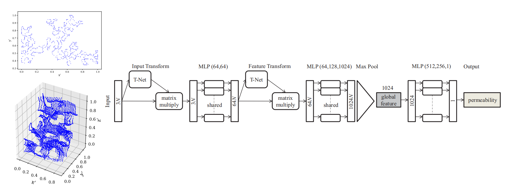
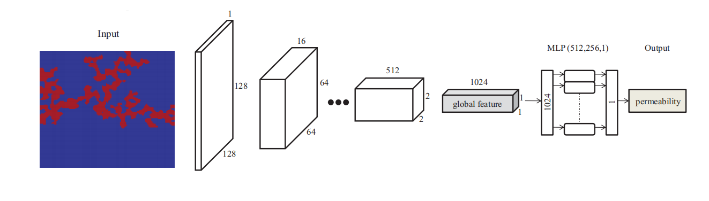

## 为多孔介质渗透性预测设计的点云深度学习框架

### 摘要

我们提出了一种用于从多孔介质数字图像预测渗透率的新型深度学习框架。使用了 PointNet 的分类分支，并对其进行了调整以适应回归任务。与卷积神经网络不同，我们没有将整个图像体视数据作为网络的输入，而是将固体基质与孔隙空间之间的边界建模为点云，并将其作为基于 PointNet 架构的神经网络的输入。这种方法克服了内存限制、批次大小选择以及收敛性等方面的挑战。该网络预测数字岩石渗透率的速度比 Lattice Boltzmann 求解器快几千倍，同时保持了较高的预测精度。

动机：

多孔介质流体流动控制方程的解决取决于颗粒-孔隙边界的形状和边界条件，因此如果能将多孔介质的颗粒-孔隙的边界输入进神经网络，就不再需要一个整体的岩石块。

好处：

将数字演岩石表示成稀疏的点云而不是二维像素或者三维体素将大大降低对GPU内存的需求，也能扩大batch size

工作：

- 为评估预测性能，我们报告了预测渗透率的决定系数以及最大和最小相对误差，这些误差以数值求解器计算的渗透率为基准，针对一组二维和三维多孔介质几何结构进行分析。
- 为了评估对不同参数的敏感性，我们将点云的点数作为本文所提出的神经网路ode超参数进行讨论
- 评估了PointNet中输入和特征转换模块对该框架性能的影响
- 探索了不同激活函数和不同尺寸的潜在全局特征对准确率的一个像
- 与CNN对比速度和性能

连续性方程与Navier-Stokes方程共同描述多孔介质孔隙内单相不可压缩流的动力学行为，其数学表达式如下：
$$
\frac{\partial \rho}{\partial t} + \nabla \cdot (\rho \mathbf{u}) = 0 \quad \text{in } V
\\

\frac{\partial (\rho \mathbf{u})}{\partial t} + \nabla \cdot (\rho \mathbf{u} \otimes \mathbf{u}) + \nabla p - \mu \Delta \mathbf{u} = \mathbf{f} \quad \text{in } V
$$
u是速度向量，p表示绝对压力，V表示充满流体的孔隙空间。ρ表示流体密度，μ表示流动粘度；f表示外力矢量

孔隙率用φ表示            渗透率用k表示

### 数据集生成

使用截断高斯模拟算法

- 创建n^2（2D）或n^3 （3D）数组
- 填充标准正态随机数
- 应用高斯核滤波器（kernel size =l_c）引入空间相关性
- 归一化到 [0,1] → 设置阈值得到目标 φ 的二值图像
- 丢弃无相关性的样本 **物理尺寸**：L=n×δx，δx=0.003m

#### 2D

- n=128
- l_c = 9（训练/验证/测试）或 l_c = 17, 33 （泛化测试）
- φ∈[0.125,0.25]
- 总样本：2600（lc=9）
- 统计：训练集 ϕ=0.181±0.03，k=121.62±18.42 mD；测试集 ϕ=0.185±0.04，k=128.52±20.95 mD

#### 3D

- n=64
- l_c = 17
- ϕ∈[0.125,0.20]
- 总样本：2175
- 统计：训练集 ϕ=0.146±0.04，k=67.12±58.03 mD；测试集 ϕ=0.151±0.05，k=69.83±61.12 mD

每张图像运行 LBM 求解器 → 计算稳态速度场 → Darcy 定律得渗透率 k （x方向）

### 神经网络域定义

因为渗透率仅依赖 颗粒-孔隙 边界几何 → 只用边界作为网络输入，无需整个体素体积

- 孔隙空间边界记为 ∂V
- 神经网络域 V_NN⊂∂V
- V_NN由 N 个点构成点云

**维度**：

- 2D：边界线上的点
- 3D：边界表面上的点

可调超参数N表示点数

### 数据预处理

#### 点云构建

#### 归一化

将输入x y z 和输出 k 统一放缩到[0, 1]，所有训练/验证/测试数据均应用此归一化
$$
k ^ { \prime } = { \frac { k - \operatorname* { m i n } ( k ) } { \operatorname* { m a x } ( k ) - \operatorname* { m i n } ( k ) } }
$$

### 点云神经网络

沿用了原PointNet经典设置，作者把分类头改为回归头

对于3D形状来说，单个样本的输入点云是X∈R^(N×3)，N=点数，3表示(x, y, z)，训练时就是批次形式R^(B×N×3)

T-Net内部是一个迷你 PointNet，结构为 MLP(64, 128, 1024) + max pooling + FC 层，最终输出一个 3×3 变换矩阵 T_input ∈R^(3×3)

matrix multiply是对齐操作：
$$
X _ { \mathrm { a l i g n e d } } = X \cdot T _ { \mathrm { i n p u t } }
$$
则X_aligned仍是N×3形状（只是做了旋转变换/对齐，使点云处于规范空间）

第一个MLP(64, 64)，输入只有3 维坐标，先升维到 64，再保持 64，输出变成N×64

___

第二个T-Net内部同样是 MLP(64, 128, 1024) + max pooling+FC层，最终输出64×64的T_feat（任务是学习一个用于特征对齐的T_feat）

然后是matrix multiply特征空间对齐（这里已经不是在处理原始输入了，而是提取后的特征）
$$
F _ { \mathrm { a l i g n e d } } = F \cdot T _ { \mathrm { f e a t } }
$$
输入F的形状为N×64，输出仍然是N×64（更高维特征空间的对齐）

第二个MLP(64, 128, 1024)，从64维开始进一步提取更复杂几何特征，输出是N×1024,1024是PointNet标准全局特征维度

___

max pooling操作
$$
g = \operatorname* { m a x } _ { i = 1 } ^ { N } h ( x _ { i } ) \in \mathbb { R } ^ { 1 0 2 4 }
$$
输出的是单个1024维向量，和点数N无关

第三个MLP(512, 256, 1)，1024-->512，压缩了

___

#### 什么是“对齐”？

一块岩石的点云，如果随便旋转100次，对于网络来说就是100个不同的物体，对齐是指让网络自己学习一个变换矩阵，把每一个点云都摆正到同一个标准姿势，这样网络就只需要学习到一个标准版本

图中input transform 是坐标对齐，即让点云被轻微旋转或放缩，让它的主方向尽量和坐标轴对齐。feature transform是在抽象的高维特征空间中做对齐

去掉两个对齐之后，2D的R^2从0.96222 掉到 0.91527

### 卷积神经网络

rapid estimation of permeability from digital rock using 3d convolutional neural network 的2.3节介绍详细的结构

与PointNet类似，需要一个编码器来提取图像特征，以及一个解码器，将学习到的特征映射到相应的渗透率。我们采用了DCGAN的编码器结构

完全采用了DCGAN编码器结构：成功的无监督生成对抗网络，其下采样结构（stride=2、无padding、无池化、滤波器翻倍）被证明在图像特征提取上非常有效

滤波器数量从16开始，每层翻倍

核大小：

2D-CNN（输入128×128图像）：所有层均为(2, 2)，**最后一层除外**（保持(2,2)）。

3D-CNN（输入64×64×64体素）：前几层均为(2, 2, 2)，**最后一层**改为(1, 1, 1)——这是为了把空间维度压到1×1×1，同时把通道数调整到使展平/全局特征正好为1024维。

### 训练

损失函数使用均方误差函数：
$$
C = \frac{1}{M} \sum_{i=1}^{M} (k'_i - \tilde{k}'_i)^2,
$$
